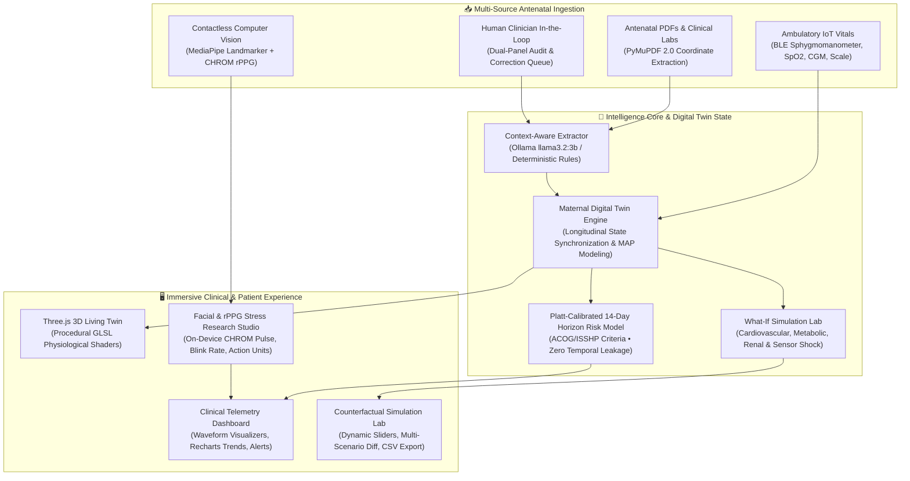

# 🌸 PregTwin (Health-Twin)
### *A Longitudinal Maternal Digital Twin & Preeclampsia Early-Warning Research Platform*

[](https://fastapi.tiangolo.com)
[](https://react.dev)
[](https://www.typescriptlang.org)
[](https://threejs.org)
[](https://developers.google.com/mediapipe)
[](https://ollama.com)
[](https://pytest.org)
[](https://vitest.dev)
[](https://opensource.org/licenses/MIT)

---

> ### *"For every mother whose heart beats for two. For every baby waiting to draw their first breath. And in solemn remembrance of the mothers we were too late to save — we build this so no mother walks the shadow of preeclampsia alone."*

---

## 🕊️ The Heart Behind PregTwin: Why This Exists

Every single day, across every continent, **over 800 women die from preventable complications of pregnancy and childbirth**. That is one mother dying every two minutes. One newborn left without the warm embrace of a mother's arms. One family shattered by an outcome that modern science could have foreseen.

Among the greatest culprits is **preeclampsia** — historically termed *the toxemia of pregnancy*. 

Preeclampsia is insidious. It does not begin with an emergency siren. It begins in silence: a subtle endothelial rebellion in the microvasculature, a modest creep in systemic vascular resistance, a faint spike of protein in the urine, or a headache brushed off by an exhausted mother as "just third-trimester fatigue." 

```
   Week 12              Week 20              Week 28              Week 34
   Normal Placentation  Endothelial Stress   Silent MAP Surge     Severe Preeclampsia
   [      🌱      ] --> [      ⚠️      ] --> [      ⚡      ] --> [      🚨      ]
                        Window of Opportunity: Early Detection & Digital Twin Surveillance
```

Too often, by the time clinical alarms ring in triage, the window of quiet prevention has slammed shut. Eclampsia, placental abruption, HELLP syndrome, cerebral edema, and emergency preterm cesarean delivery follow in rapid, terrifying succession. In under-resourced hospitals and underserved communities, the toll is catastrophic — Black and Indigenous mothers in high-income nations face three- to four-fold higher mortality, while in low-resource settings, basic longitudinal surveillance remains a distant dream.

**PregTwin is our response.**

PregTwin was not conceived as a cold academic exercise or an automated diagnostic box. It is an empathetic, high-precision **Maternal Digital Twin** designed to stand vigil between clinic visits. It listens to longitudinal antenatal reports, continuous ambulatory IoT telemetry, contactless optical pulse micro-fluctuations, and historical maternal hemodynamics. It builds a living, breathing computational twin that empowers obstetricians, midwives, and mothers to see the storm gathering on the horizon **two weeks before it strikes**.

---

## ✨ System Architecture & Key Capabilities



---

## 🔬 Core Innovations

### 1. 🫀 The Living 3D Maternal Twin (Three.js + Procedural GLSL)
Rather than presenting clinicians with a sterile spreadsheet of numbers, PregTwin translates complex hemodynamic data into an intuitive, organic 3D maternal representation:
- **Physiological Shader A (Ambient Cellular Field):** Multi-scale simplex noise modulating procedural interference patterns that simulate maternal micro-perfusion and cellular oxygenation.
- **Data-Reactive Shader B (Hemodynamic Signal Field):** Real-time pulse velocity, orbital ring frequencies, and particle drift rates dynamically coupled to the patient's **Mean Arterial Pressure (MAP)**, Systolic/Diastolic BP, and gestational age.

### 2. 🧪 Advanced What-If Simulation Lab
Clinicians can test hypothetical clinical interventions in a risk-free counterfactual playground:
- **Cardiovascular Hemodynamics:** Adjust SBP, DBP, resting heart rate, and systemic arterial stiffness to project 14-day preeclampsia probability deltas.
- **Metabolic & Glycemic Strain:** Model fasting glucose, HbA1c, and insulin sensitivity shifts.
- **Renal & Endothelial Health:** Simulate changes in Protein-to-Creatinine Ratio (UPCR), spot urine dipstick, and platelet consumption.
- **Sensor Reliability & Ambulatory Noise:** Stress-test twin predictions under sensor signal degradation and missing data.
- **Scenario Management:** Save, duplicate, compare, and export counterfactual scenarios as authenticated CSV/JSON reports.

### 3. 📹 Live Contactless Facial & Stress Analysis (MediaPipe + CHROM rPPG)
Expectant mothers under acute psychosocial stress experience sympathetic nervous system overactivation, directly elevating blood pressure and vascular tone:
- **MediaPipe 3D Mesh Tracking:** 478 landmark points tracking eyebrow tension, eye aspect ratio (EAR), blink velocity, mouth compression, and head pose stability.
- **Chrominance (CHROM) rPPG:** Mathematical extraction of subtle, invisible pulse-induced green-red spectral shifts on the facial epidermis using ordinary webcams to estimate resting heart rate without touching the patient.
- **100% On-Device & Private:** Every video frame is analyzed locally in WebAssembly. No video feed or facial biometric data ever leaves the user's browser.

### 4. 📄 Clinical Document Understanding & Audit Integrity
- **PyMuPDF Coordinate Extraction:** Automatically parses unstructured antenatal surveillance reports, locating blood pressures, lab tests, ultrasound scans, and fundal heights with exact page bounding boxes.
- **Context-Aware Date Disambiguation:** Intelligently separates historical baseline lab results from current visit measurements regardless of reading order.
- **Human-in-the-Loop Review:** Clinicians can inspect extracted values side-by-side with original PDF vector coordinates, accept, modify, or reject observations with full cryptographic audit logging.

### 5. 🛡️ Strict ACOG / ISSHP Clinical Guardrails
- **Minimum Gestational Age Guard:** Strict $\ge 20.0$ weeks threshold enforced per American College of Obstetricians and Gynecologists (ACOG) and International Society for the Study of Hypertension in Pregnancy (ISSHP) criteria. Early pregnancies automatically display an `INSUFFICIENT_DATA` safety guard.
- **Zero Temporal Data Leakage:** All predictive features are temporally isolated strictly at or before $t_{\text{prediction}}$. No future observation can ever contaminate baseline inference.

---

## 💻 Tech Stack & Architecture

### Backend
- **Framework:** Python 3.14+ • FastAPI (High-performance asynchronous REST API)
- **Database:** SQLite (zero-config local) / PostgreSQL-ready via SQLAlchemy 2.0 ORM
- **Security:** PBKDF2-HMAC-SHA256 password hashing, JWT Bearer tokens with query fallback, Role-Based Access Control (`clinician`, `patient`, `admin`)
- **Document Processing:** PyMuPDF 2.0 (`pymupdf`), Tesseract OCR Adapter
- **AI Intelligence:** Local Ollama (`llama3.2:3b`), OpenAI GPT-4o adapter, and deterministic clinical ontology engine with bounding-box coordinate mapping

### Frontend
- **Framework:** React 19 • TypeScript • Vite 8
- **Styling:** Tailwind CSS v4 with custom Clinical Dark aesthetic (`#070B14`, `#5BE7E8`, `#628BFF`, `#E9B96E`)
- **3D Visualization:** Three.js r183 with custom WebGL GLSL vertex & fragment shaders
- **Computer Vision:** Google MediaPipe Face Landmarker WebAssembly + Custom CHROM rPPG Engine
- **Data Visualization:** Recharts for longitudinal hemodynamic trajectories and feature contribution waterfalls

---

## 🚀 Quickstart & Local Installation

### Prerequisites
- **Python:** 3.11+ (Python 3.14 fully supported)
- **Node.js:** v18+ (Node 20+ recommended)
- **Git**
- *(Optional)* [Ollama](https://ollama.com/) with `llama3.2:3b` for local AI document extraction

---

### Step 1: Clone the Repository
```bash
git clone https://github.com/vatsalpro/health-twin.git
cd health-twin
```

---

### Step 2: Backend Setup
```bash
cd backend

# Create and activate virtual environment
python -m venv .venv
# Windows:
.venv\Scripts\activate
# Linux/macOS:
source .venv/bin/activate

# Install dependencies
pip install -r requirements.txt

# Run database setup & synthetic demonstration data seeding
python -m app.seed.seed_data

# Start the FastAPI backend server
python -m uvicorn app.main:app --port 8008 --reload
```
*The backend API and interactive Swagger documentation will be live at `http://127.0.0.1:8008/docs`.*

---

### Step 3: Frontend Setup
In a new terminal window:
```bash
cd frontend

# Install npm dependencies
npm install

# Start Vite development server
npm run dev
```
*Open your browser and navigate to `http://localhost:5173`.*

---

## 👥 Seed Demonstration Profiles

For instant evaluation, the platform includes pre-configured synthetic maternal profiles representing distinct clinical risk trajectories:

| Role | Email | Password | Clinical Context |
| :--- | :--- | :--- | :--- |
| **Attending Clinician** | `dr.elena@pregtwin.org` | `Clinician2026!` | Dr. Elena Vance, MD, FACOG — full access to clinician review queue, audit trail, and all patient twins |
| **Patient 1 (High Risk)** | `maya.lin@pregtwin.org` | `Patient2026!` | Maya Lin (31yo, G2P0, GA 31.4w) — rising SBP trajectory (122 $\to$ 142 mmHg), 1+ proteinuria, high preeclampsia risk |
| **Patient 2 (Moderate Risk)** | `sophia.reyes@pregtwin.org` | `Patient2026!` | Sophia Reyes (36yo, GA 28.0w) — chronic hypertension, history of preeclampsia, monitored closely |
| **Patient 3 (Early Guard)** | `clara.novak@pregtwin.org` | `Patient2026!` | Clara Novak (26yo, GA 16.0w) — triggers strict $<20.0$ week `INSUFFICIENT_DATA` safety guard |

---

## 🧪 Comprehensive Verification & Test Suites

The codebase includes exhaustive automated regression and unit tests:

```bash
# Run 45 Backend Pytest Tests (100% Passing)
cd backend
python -m pytest tests/ -v

# Run 9 Frontend Vitest Tests (100% Passing)
cd frontend
npx vitest run

# Run Frontend Production Build & TypeScript Typecheck
npm run build
```

```
============================= 45 passed in 43.81s =============================
Test Files  1 passed (1)
     Tests  9 passed (9)
Vite Production Build: 0 errors
```

---

## 🩺 Clinical Evidence Levels & Transparency

PregTwin strictly maintains evidence provenance across every screen:
1. **🟢 Verified Clinical Measurements:** Sourced from certified clinical laboratory reports and physician sphygmomanometers.
2. **🔵 Patient-Reported Telemetry:** Ambulatory readings flagged as home-monitored.
3. **🟣 AI-Extracted Values:** Fields extracted by OCR/LLM with explicit coordinate bounding boxes and confidence scores.
4. **🟡 Human-in-the-Loop Verified:** Fields reviewed, corrected, or approved by an attending clinician.
5. **🟠 Model Risk Forecasts:** Calibrated 14-day probabilities accompanied by 95% confidence intervals and SHAP-inspired feature contribution rankings.
6. **⚪ Counterfactual Scenarios:** Clearly labeled as non-causal exploratory hypotheses.

---

## ⚖️ Ethics, Privacy & Responsible AI Disclaimer

> **IMPORTANT CLINICAL NOTICE:**  
> PregTwin is a **research and clinical decision-support prototype**. It is **not** an autonomous diagnostic device, medical software approved for unsupervised patient triage, or a substitute for professional clinical judgment, emergency medical services, or obstetric consultations.  
> 
> All patient records included in the default database seed (`Maya Lin`, `Sophia Reyes`, `Clara Novak`) are **100% synthetic, procedurally generated demonstration fixtures**. No protected health information (PHI) is contained within this repository. Camera-based stress and rPPG analysis runs entirely in local client memory and does not record or transmit raw video streams.

---

## 🤝 Contributing

We welcome researchers, obstetricians, biomedical engineers, and developers dedicated to advancing maternal health equity. Please see [CONTRIBUTING.md](CONTRIBUTING.md) or submit an issue/pull request.

---

## 📜 License & Acknowledgments

This project is licensed under the **MIT License** — see the [LICENSE](LICENSE) file for details.

### Heartfelt Gratitude
- Dedicated to the midwives, obstetricians, maternal-fetal medicine specialists, and nurses who work tirelessly to protect mothers and babies.
- Built with gratitude for open-source communities powering modern medical research: FastAPI, PyMuPDF, Three.js, MediaPipe, React, and Vite.

---

<p align="center">
  <b>PregTwin</b> • <i>Every beat matters. Every mother matters.</i><br>
  Developed with ❤️ for Maternal Health Everywhere.
</p>
